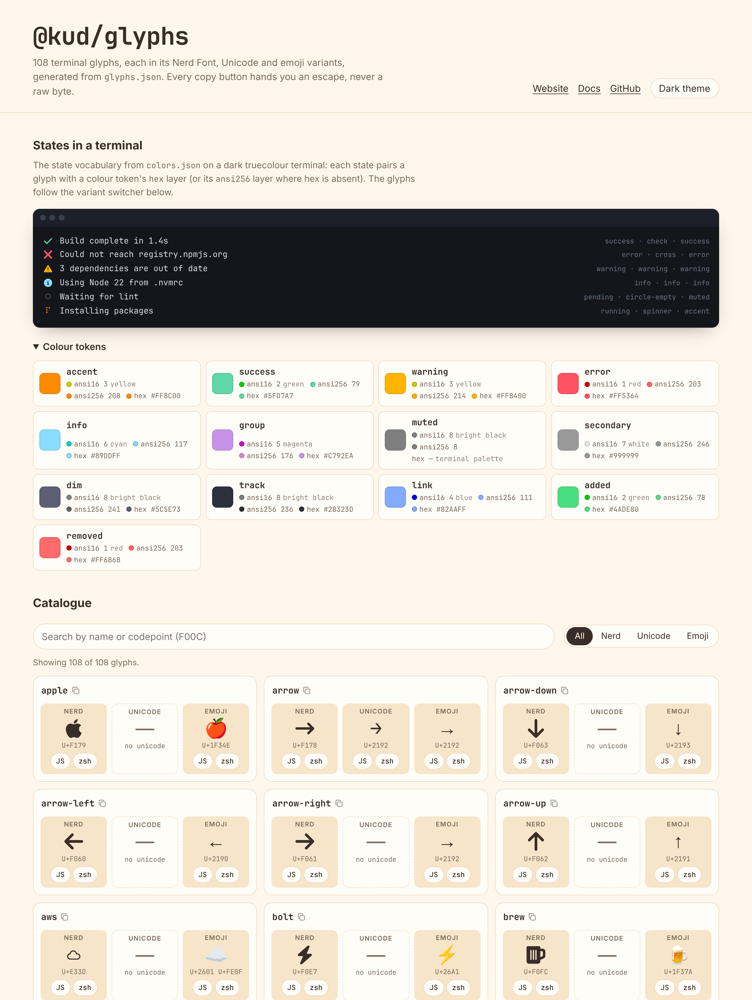
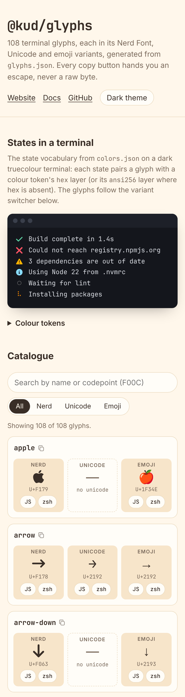

<div align="center">


**Multi-language source of truth for terminal glyphs — Nerd Font codepoints and unicode fallbacks, typed and escape-safe**

<a href="https://kud.io/projects/glyphs">Website</a> · <a href="https://kud.io/projects/glyphs/docs">Documentation</a> · <a href="https://kud.io/projects/glyphs/demo">Demo</a>

</div>

## Features

- **One source, many outputs** — a single `glyphs.json` (`name → { nerd, unicode?, emoji? }`) generates every language binding, so no project hand-maps codepoints again.
- **Escapes by construction** — codepoints are always emitted as normalised escapes (`\u{XXXX}` in TypeScript, `$'\U0000XXXX'` in zsh), never as raw Private-Use-Area bytes that are invisible in editors and mangle in diffs.
- **Typed TypeScript API** — a `glyphs` record, a `glyph(name, variant?)` lookup with a `GlyphName` union that rejects typos at compile time, and a `Variant` type (`"nerd" | "unicode" | "emoji"`).
- **Consumer-agnostic zsh rendering** — `renderZsh({ prefix, variant, names })` emits `$prefix_NAME=...` assignments under whatever namespace the caller wants. The library names no specific consumer.
- **Multi-scalar emoji handled correctly** — emoji values are literal strings that may be grapheme clusters (`⚠️` = U+26A0 U+FE0F), stored and escaped as a sequence rather than a single codepoint.

## Install

```sh
npm install @kud/glyphs
```

## Usage

### TypeScript

```ts
import { glyphs, glyph, renderZsh } from "@kud/glyphs"

glyphs.check.nerd // nerd-font check mark (U+F00C)
glyph("check") // same — defaults to the nerd variant
glyph("check", "emoji") // "✓"
glyph("plArrowRight", "unicode") // "" — absent variants resolve to ""
```

### zsh — via the published plugin

Load the repo as a plugin — no npm involved. `glyphs.plugin.zsh` sources
`ICON_*` variables (nerd variant) directly:

```zsh
# antidote — add to ~/.zsh_plugins.txt
kud/glyphs

# zinit
zinit light kud/glyphs

# oh-my-zsh — clone into $ZSH_CUSTOM/plugins/glyphs, then add `glyphs` to plugins=()
```

```zsh
print -P "$ICON_CHECK done"
echo "$ICON_ARROW_RIGHT next"
```

### zsh — custom prefix (no node)

Want your own namespace instead of `ICON_*`? Each variant is published as a
plain, escape-safe zsh file under `zsh/`. Substitute the prefix with `sed` — no
node, no runtime dependency, values untouched (the swap is anchored to the
variable name, never the `$'\U…'` payload):

```zsh
# nerd glyphs under a SHUI_ICON_ prefix (swap `main` for a release tag to pin)
curl -fsSL https://raw.githubusercontent.com/kud/glyphs/main/zsh/nerd.zsh \
  | sed 's/^ICON_/SHUI_ICON_/' > icons.zsh

source icons.zsh
# icons.zsh contains:
#   SHUI_ICON_CHECK=$'\U0000F00C'
#   SHUI_ICON_CROSS=$'\U0000F00D'
```

Variants live at `zsh/{nerd,emoji,unicode}.zsh` (`unicode.zsh` holds only the
glyphs that have a plain-Unicode fallback). This is exactly how
[shui](https://github.com/kud/shui) builds its icon sets — a `sed` re-prefix run
only when it bumps this package, sourcing plain literal files at runtime.

For JavaScript/TypeScript consumers, `renderZsh({ prefix?, variant?, names? })`
does the same in code: `prefix` defaults to `ICON`, `variant` to `nerd`, and
`names` restricts and orders the output. A glyph lacking the requested variant
emits an empty value (`NAME=''`), so cross-set parity holds.
Escapes are produced by construction — never raw PUA bytes.

> Nerd Font glyphs need a [Nerd Font](https://www.nerdfonts.com/) installed in
> your terminal; without one they render as a `□` box.

## Colour tokens

`colors.json` holds a shared semantic colour vocabulary — data only, never
rendering. Tokens mean the same thing in every consumer; they need not look
identical.

**The ANSI floor is the contract.** Every token has three layers: `ansi16` (a
16-colour palette index, 0–15 — the meaning every consumer must honour),
`ansi256` (the 256-colour fallback) and `hex` (an optional dark-truecolour
layer). Using `hex` is the consumer's decision, taken only when the terminal
has truecolour _and_ a known dark background; that logic does not live here.
`muted` deliberately has no `hex`: it is always the terminal's bright black.

| Token       | ansi16             | ansi256 | hex       |
| ----------- | ------------------ | ------- | --------- |
| `accent`    | 3 yellow           | 208     | `#FF8C00` |
| `success`   | 2 green            | 79      | `#5FD7A7` |
| `warning`   | 3 yellow           | 214     | `#FFB400` |
| `error`     | 1 red              | 203     | `#FF5364` |
| `info`      | 6 cyan             | 117     | `#89DDFF` |
| `group`     | 5 magenta          | 176     | `#C792EA` |
| `muted`     | 8 bright black     | 8       | —         |
| `secondary` | 7 white            | 246     | `#999999` |
| `dim`       | 8 bright black     | 241     | `#5C5E73` |
| `track`     | 8 bright black     | 236     | `#2B323D` |
| `link`      | 4 blue             | 111     | `#82AAFF` |
| `added`     | 2 green            | 78      | `#4ADE80` |
| `removed`   | 1 red              | 203     | `#FF6B6B` |

States pair a glyph (which carries the meaning) with a colour token (which only
reinforces it): `success` → `check` ✓, `error` → `cross` ✗, `warning` →
`warning` ⚠, `info` → `info` ℹ, `pending` → `circle-empty` ○ in `muted`, and
`running` → a spinner in `accent`.

```ts
import { colors, states } from "@kud/glyphs"
import type { ColorToken, State } from "@kud/glyphs"

colors.accent // { ansi16: 3, ansi256: 208, hex: "#FF8C00" }
states.pending // { glyph: "circleEmpty", color: "muted", spinner: false }
```

In zsh, `zsh/colors.zsh` is static assignments only (no functions, no
subshells), safe on a shell's startup path — `COLOR_ACCENT_ANSI16=3`,
`COLOR_ACCENT_HEX='#FF8C00'`, `STATE_PENDING_GLYPH='CIRCLE_EMPTY'`,
`STATE_PENDING_COLOR='MUTED'`. Re-prefix it like the glyph files:

```zsh
sed -E 's/^(COLOR|STATE)_/SHUI_&/' zsh/colors.zsh > colors.zsh
# SHUI_COLOR_ACCENT_ANSI16=3
```

## Demo

Every glyph, rendered: **[kud.io/projects/glyphs/demo](https://kud.io/projects/glyphs/demo)**.
Each card shows the Nerd Font, Unicode and emoji variants side by side, with
their codepoints and one-click copy of the JavaScript (`\u{F00C}`) and zsh
(`$'\U0000F00C'`) escapes. A switcher narrows the view to one variant, and a
terminal strip shows the state vocabulary in its `colors.json` colours.

<p align="center">
  
  
</p>

The page is generated from `glyphs.json` and `colors.json` at build time, so it
never drifts from the data (a test checks that every glyph is listed). It
bundles [Symbols Nerd Font Mono](https://github.com/ryanoasis/nerd-fonts) so
the Private-Use-Area glyphs render without a local Nerd Font.

```sh
npm run demo          # dev server with live reload on glyphs.json / colors.json
npm run demo:build    # static build into demo/dist, served under /projects/glyphs/demo
```

## Adding a glyph

Edit `glyphs.json`, then regenerate:

```sh
npm run generate   # glyphs.json -> src/generated.ts, glyphs.plugin.zsh, zsh/*.zsh
```

Colours work the same way: edit `colors.json` and run `npm run generate`
(also writes `src/colors.generated.ts` and `zsh/colors.zsh`). The tests run
`node scripts/generate.mjs --check` and fail if any generated file has drifted.

## Development

```sh
git clone https://github.com/kud/glyphs.git
cd glyphs
npm install
npm run generate
npm run build      # generate, then tsup -> dist
npm run typecheck
npm test
```

📚 **Full documentation → [glyphs/docs](https://kud.io/projects/glyphs/docs)**
